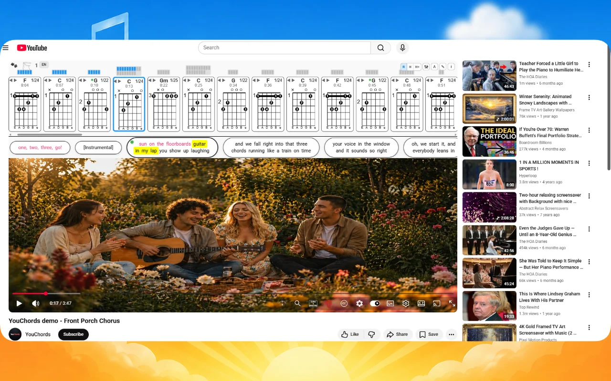
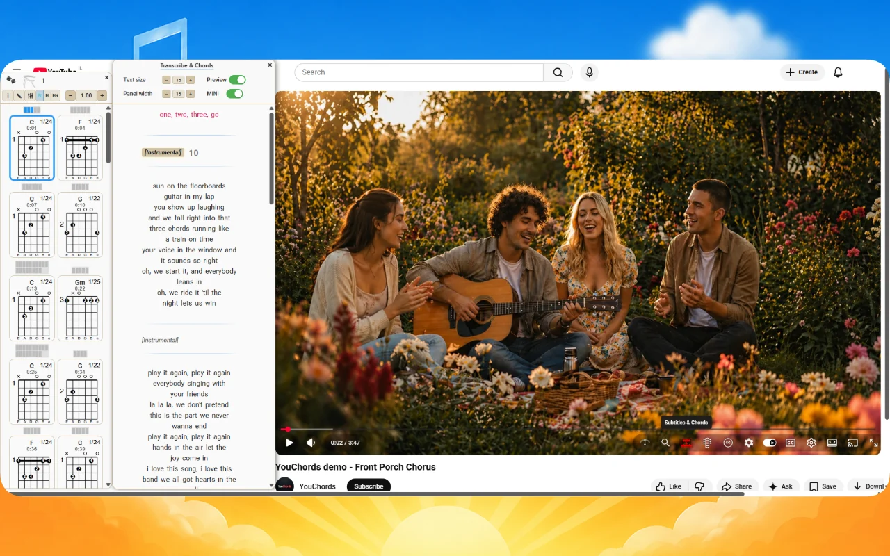
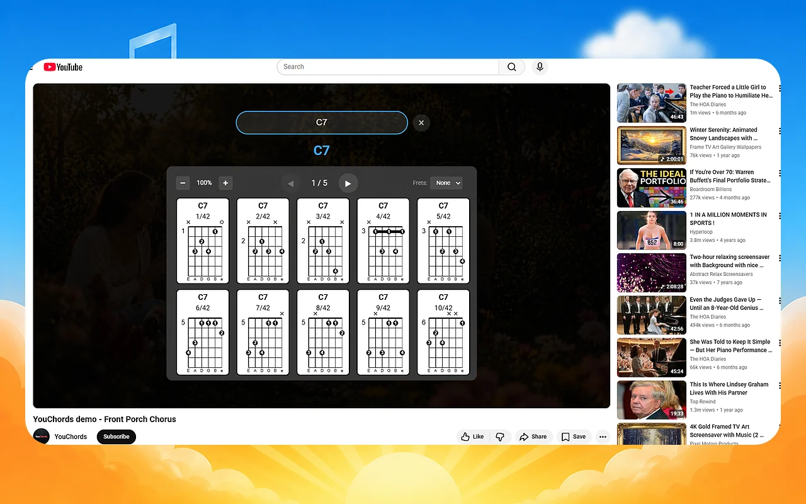
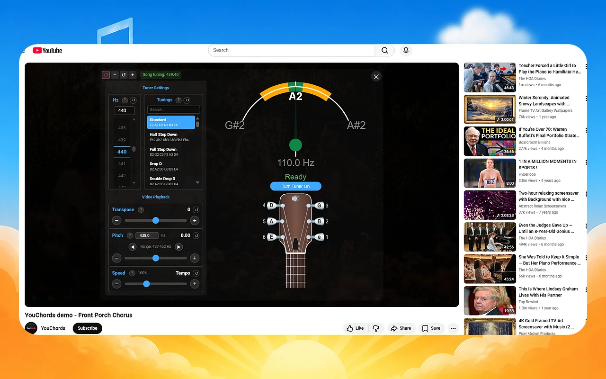
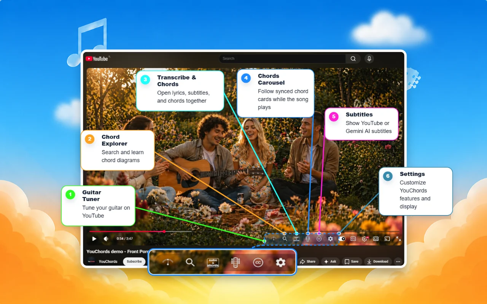

# YouChords Local

YouChords is becoming a free, open-source, local-first chord recognition tool
for YouTube videos and local audio files.

> **Project status: early alpha.** The local Chordino companion now builds and
> processes audio in Docker. The Chrome extension adapter is available for
> testing, but the project still needs broader browser and media coverage.

## The goal

The finished community edition will run chord analysis on the user's computer:

1. accept a local audio file or a permitted media URL;
2. prepare audio locally with FFmpeg and yt-dlp where appropriate;
3. run Chordino / NNLS Chroma locally;
4. return YouChords chord timelines to the browser extension;
5. cache results locally and remove temporary media safely.

No account, subscription, device fingerprinting, billing service, or hosted
YouChords backend will be required.

## See it in action

| Synced chord carousel | Lyrics and chords |
| --- | --- |
|  |  |

| Chord explorer | Guitar tuner |
| --- | --- |
|  |  |



## What is in this repository

- `apps/extension/` - the account-free Chrome extension connected only to the
  local companion.
- `apps/local-companion/` - the FastAPI, yt-dlp, FFmpeg, Sonic Annotator, and
  Chordino processing service.
- `apps/extension-legacy/` - sanitized source snapshot of the former Chrome
  extension, retained as the UI and behavior reference for the local edition.
- `docs/LOCAL_FIRST_ROADMAP.md` - architecture, security, licensing, and release
  gates for the local companion.
- `docs/LEGACY_EXTENSION.md` - why the snapshot is not currently installable.
- `THIRD_PARTY_NOTICES.md` - attribution and licensing notes.

The private production backend, billing code, credentials, user data, logs,
deployment tooling, proxy infrastructure, and historical Git repository are
intentionally not included.

## Planned layout

```text
apps/
  extension/
  local-companion/
engine/
  chord-pipeline/
packages/
  chord-format/
docker/
docs/
```

## Install the alpha on Windows

Docker Desktop must be installed and running. Then execute this one setup
command in PowerShell:

```powershell
irm https://raw.githubusercontent.com/yuval-kahan/youchords-local/main/install.ps1 | iex
```

Chrome requires one final manual **Load unpacked** click. The installer opens
the correct page and copies the extension path to the clipboard. See the
[Windows installation guide](docs/INSTALL_WINDOWS.md) for details.

## Contributing

Contributions are welcome. Start with [CONTRIBUTING.md](CONTRIBUTING.md) and the
[local-first roadmap](docs/LOCAL_FIRST_ROADMAP.md). Please do not submit API
keys, cookies, copyrighted media, production credentials, or bypass tooling.

## Responsible use

Users are responsible for having permission to access and process media. Local
files are a first-class input. URL support must respect applicable terms,
copyright, access controls, and local law.

## License

YouChords source in this repository is licensed under
**GPL-2.0-or-later**. See [LICENSE](LICENSE). Third-party components and datasets
retain their own licenses as described in [THIRD_PARTY_NOTICES.md](THIRD_PARTY_NOTICES.md).
